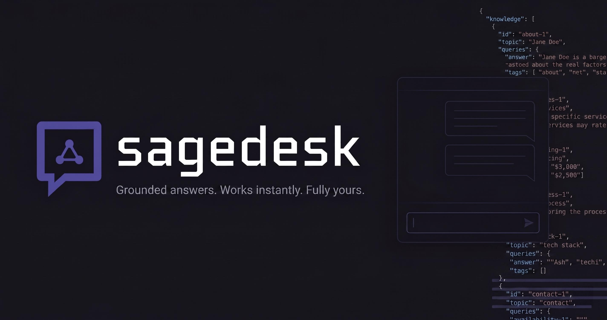

<div align="center">
  
  <h1 style="margin-top: 16px;">SageDesk</h1>
  <p>RAG-powered support chat widget for any website. Run entirely in the browser with no API key, or connect your own backend for LLM-synthesized answers.</p>
</div>

<br/>

<p align="center"><a href="https://www.npmjs.com/package/sagedesk"></a> <a href="./LICENSE"></a> <a href="https://github.com/mzeeshanwahid/sagedesk/actions"></a> <a href="https://www.typescriptlang.org/"></a></p>

---

## Operating Modes

sagedesk ships two modes. Pick the one that fits your needs.

### Local Mode (default)

All embedding and semantic search runs entirely in the visitor's browser via WebAssembly. No API key required. No backend. No per-query cost.

1. **Build time** - Run `npx sagedesk build` on your machine. It reads your `knowledge.json`, embeds every entry using a local transformer model (default: `all-MiniLM-L6-v2`), and writes a minified vector index to a static JSON file.
2. **Runtime** - The widget fetches the index and loads the same model via WebAssembly. Visitor queries are embedded in-browser and matched against the index using optimized semantic search in under 100ms. **No API call is ever made.**

### LLM Mode

The widget posts the visitor's question, `{ query }`, to your own backend. Your backend reads your `knowledge.json`, places it in the system prompt, and asks your LLM provider to answer from it. The API key lives in your environment variables and never touches the browser. sagedesk provides ready-made server handlers for Next.js and Express, and you own your entire stack.

Nothing is downloaded into the browser and no WebAssembly runs: the widget is usable the moment it opens. The server loads no model either, so it deploys cleanly on Vercel, AWS Lambda, and any other serverless platform with no special configuration. You don't need `npx sagedesk build` for LLM mode.

For large knowledge bases, the server can instead run a vector search against a prebuilt index (`retrieval: 'vector'`, the 2.x behaviour). See [Retrieval strategies](#retrieval-strategies).

| | Local Mode | LLM Mode |
|---|---|---|
| API key required | No | Yes, yours |
| Backend required | No | Yes, yours |
| sagedesk infrastructure | None | None |
| Answer style | Exact retrieval | Natural, synthesized |
| Latency | < 100ms | 1–3 seconds |
| Cost | Zero | Per-query LLM API cost (the knowledge base is sent with every question) |
| Browser download | Embedding model (~23 MB) and WASM runtime | None |
| Build step | `npx sagedesk build` | None (`knowledge.json` is read directly) |
| Privacy | Fully local | Query sent to your LLM provider |
| Error resilience | N/A | Built-in: timeouts, fallbacks, automatic recovery |

---

## Framework Support

| | Supported |
|---|---|
| **Frontend** | Vanilla HTML/JS, React, Next.js (App Router) |
| **Backend** (LLM Mode) | Next.js API Routes, Express, any Node.js server, Vercel, AWS Lambda |

---

## Installation

```bash
npm install sagedesk
```

---

## Local Mode Setup

### Step 1 - Write your knowledge file

Create `knowledge.json` at the root of your project.

```json
{
  "knowledge": [
    {
      "id": "about-1",
      "queries": [
        "Who built this site?",
        "Who is the developer?",
        "Tell me about the author"
      ],
      "answer": "This site was built by Jane Doe, a full-stack developer specialising in React and Node.js."
    },
    {
      "id": "services-1",
      "question": "What services do you offer?",
      "answer": "We offer web development, API design, and technical consulting."
    }
  ]
}
```

#### Knowledge Schema

| Field | Type | Required | Description |
|---|:---:|:---:|---|
| `knowledge[].id` | `string` | yes | Unique identifier for the entry. |
| `knowledge[].queries` | `string[]` | no | **Recommended.** Multiple phrasings for better matching. |
| `knowledge[].question` | `string` | no | Legacy single-question field. |
| `knowledge[].answer` | `string` | yes | The answer text shown to visitors. |

---

### Step 2 - Build the index

```bash
npx sagedesk build --input knowledge.json --output public/support-index.json
```

This generates the vector index. Re-run it whenever your knowledge file changes.

#### CLI Options

| Option | Description | Default |
|---|---|:---:|
| `-i, --input <path>` | Path to knowledge JSON | **Required** |
| `-o, --output <path>` | Output path for index JSON | `./public/support-index.json` |
| `--model <name>` | Embedding model to use | `all-MiniLM-L6-v2` |
| `--minScore <number>` | Confidence threshold (0.0–1.0) | `0.42` |
| `--verbose` | Print chunk details during build | `false` |

---

### Step 3 - Add the widget

#### Vanilla HTML / JS

```html
<script type="module">
  import { init } from 'https://esm.sh/sagedesk';

  init({
    indexUrl: '/support-index.json',
    agent: {
      name: 'Support',
      greeting: 'Hey! How can I help you today?',
      accentColor: '#534AB7',
      theme: 'classic'
    }
  });
</script>
```

#### React

```tsx
import { SageDeskWidget } from 'sagedesk/react';

export default function App() {
  return (
    <SageDeskWidget
      indexUrl="/support-index.json"
      agent={{
        name: 'Support',
        accentColor: '#534AB7',
        theme: 'light'
      }}
    />
  );
}
```

#### Next.js (App Router)

Place in your root layout for site-wide availability.

```tsx
// app/layout.tsx
import { SageDeskNext } from 'sagedesk/next';

export default function RootLayout({ children }) {
  return (
    <html lang="en">
      <body>
        {children}
        <SageDeskNext
          indexUrl="/support-index.json"
          agent={{
            name: 'Support',
            theme: 'dark'
          }}
        />
      </body>
    </html>
  );
}
```

---

## LLM Mode Setup

LLM mode needs the `knowledge.json` from [Step 1](#step-1---write-your-knowledge-file) above. It does not need the built index. You also need an API key from any supported provider (OpenAI, Anthropic, Gemini, DeepSeek, Groq, or any OpenAI-compatible service).

### Step 1 - Add your API key

Add your key to your backend's environment variables. It must never be exposed to the browser.

```
SAGEDESK_LLM_API_KEY=sk-...
```

### Step 2 - Register the server handler

sagedesk exports a server handler from `sagedesk/server`. Drop it into your existing backend - no new server required.

#### Next.js App Router

```ts
// app/api/sagedesk/route.ts
import { createSageDeskHandler } from 'sagedesk/server';
import { resolve } from 'path';

export const POST = createSageDeskHandler({
  knowledgePath: resolve(process.cwd(), 'knowledge.json'),
  provider: 'deepseek',
  apiKey: process.env.SAGEDESK_LLM_API_KEY!,
  model: 'deepseek-chat',
});
```

#### Express

```ts
import express from 'express';
import { createSageDeskMiddleware } from 'sagedesk/server';
import { resolve } from 'path';

const app = express();
app.use(express.json());

app.use('/api/sagedesk', createSageDeskMiddleware({
  knowledgePath: resolve(process.cwd(), 'knowledge.json'),
  provider: 'openai',
  apiKey: process.env.SAGEDESK_LLM_API_KEY!,
  model: 'gpt-4o-mini',
}));
```

> **Serverless ready.** The handler does no embedding. It reads `knowledge.json` once, caches it in memory, and proxies one HTTP call to your LLM provider. There is no `@huggingface/transformers` import, no `onnxruntime-node`, and no native binaries on the server, and the browser downloads no model either.
>
> On Vercel, make sure `knowledge.json` is bundled into the function. A file outside `public/` read with `fs` may need to be traced explicitly:
>
> ```ts
> // next.config.ts
> export default {
>   outputFileTracingIncludes: { '/api/sagedesk': ['./knowledge.json'] },
> };
> ```

### Retrieval strategies

The handler chooses what the LLM sees in one of two ways:

| `retrieval` | Needs | Widget sends | How it works |
|---|---|---|---|
| `'context'` (default when `knowledgePath` is set) | `knowledgePath` | `{ query }` | The whole knowledge base goes in the system prompt. The LLM decides whether it answers the question. |
| `'vector'` (default when only `indexPath` is set) | `indexPath` from `npx sagedesk build` | `{ query, queryVector }` | The 2.x behaviour. The widget embeds the query in the browser (set `llm={{ embedQuery: true }}`), and the server sends the top matching chunks to the LLM. |

Context retrieval suits the knowledge bases sagedesk targets: a support FAQ or a portfolio of a few dozen entries. A 50 entry, 40 KB `knowledge.json` is roughly 7,000 tokens.

If the knowledge base grows past `maxContextTokens` (default `24000` estimated tokens), the server stops sending all of it and sends only the `topK` entries (default `8`) that best match the question by keyword. It logs one warning when this first happens. Keyword matching is weaker than vector search, so a knowledge base that size is a better fit for `retrieval: 'vector'`.

> **Check your model's context window.** `maxContextTokens` must leave room for the system prompt, the question, and a 512 token answer. Small-context models (for example 8K models) need a lower value, such as `maxContextTokens: 5000`.

When the knowledge does not contain the answer, the model replies with a sentinel the server turns into the standard fallback, so the visitor sees your `agent.fallback` text.

### Step 3 - Configure the widget

Point the widget at your endpoint with `mode="llm"`. No `indexUrl` needed on the client, and no model is loaded in the browser.

#### React

```tsx
import { SageDeskWidget } from 'sagedesk/react';

export default function App() {
  return (
    <SageDeskWidget
      mode="llm"
      endpoint="/api/sagedesk"
      agent={{
        name: 'Support',
        theme: 'dark'
      }}
    />
  );
}
```

#### Next.js (App Router)

```tsx
// app/layout.tsx
import { SageDeskNext } from 'sagedesk/next';

export default function RootLayout({ children }) {
  return (
    <html lang="en">
      <body>
        {children}
        <SageDeskNext
          mode="llm"
          endpoint="/api/sagedesk"
          agent={{
            name: 'Support',
            theme: 'dark'
          }}
        />
      </body>
    </html>
  );
}
```

### Supported LLM Providers

The `provider` field accepts either a **provider name string** or a **full API base URL**. Use a provider name for built-in support, or pass a custom URL if you're using a self-hosted model or a provider not listed below.

#### Built-in Providers

OpenAI, Gemini, DeepSeek, and Groq all use the OpenAI-compatible chat completions format. Anthropic uses its own wire format and is handled natively.

| Provider | `provider` value | Example model |
|---|---|---|
| OpenAI | `'openai'` | `gpt-4o-mini` |
| Anthropic (Claude) | `'anthropic'` | `claude-haiku-4-5-20251001` |
| Google Gemini | `'gemini'` | `gemini-2.0-flash` |
| DeepSeek | `'deepseek'` | `deepseek-chat` |
| Groq | `'groq'` | `llama3-8b-8192` |

#### Custom Providers

If your provider is not listed above, pass the full API base URL as the `provider` value:

```ts
createSageDeskHandler({
  knowledgePath: './knowledge.json',
  provider: 'https://api.example.com/v1',  // Custom base URL
  apiKey: process.env.CUSTOM_LLM_API_KEY!,
  model: 'your-model-name',
});
```

### Server Handler Options (`SageDeskHandlerConfig`)

| Option | Type | Required | Description |
|---|:---:|:---:|---|
| `knowledgePath` | `string` | one of the two | Filesystem path to your `knowledge.json`. Enables context retrieval. |
| `indexPath` | `string` | one of the two | Filesystem path to the built index JSON. Required for `retrieval: 'vector'`. |
| `retrieval` | `'context'`, `'vector'` | no | See [Retrieval strategies](#retrieval-strategies). Defaults to `'context'` when `knowledgePath` is set, otherwise `'vector'`. |
| `provider` | `string` | yes | Provider name (e.g., `'openai'`, `'anthropic'`) or full API base URL (e.g., `'https://api.example.com/v1'`). |
| `apiKey` | `string` | yes | LLM API key (server-side only). |
| `model` | `string` | yes | Model name passed to the provider. |
| `systemPrompt` | `string` | no | Context retrieval: the base prompt (persona, tone, style rules). The server always appends the answer rules and the knowledge base after it. Vector retrieval: replaces the whole system prompt. |
| `maxContextTokens` | `number` | no | Context retrieval. Largest knowledge prompt in estimated tokens (characters / 4). Defaults to `24000`. |
| `topK` | `number` | no | Vector retrieval: chunks sent to the LLM, default `5`. Context retrieval: entries sent when the knowledge base exceeds `maxContextTokens`, default `8`. |
| `minScore` | `number` | no | Vector retrieval. Minimum similarity score for a chunk. Defaults to `0.42`. |
| `llmTimeoutMs` | `number` | no | Timeout for LLM API calls in milliseconds. Defaults to `15000` for context retrieval and `5000` for vector retrieval. |
| `cacheTtlMs` | `number` | no | Context retrieval. Cache answers to identical questions for this long. Defaults to `0` (off). See [Security](#security-llm-mode). |
| `promptCache` | `boolean` | no | Mark the system prompt with Anthropic `cache_control` so the knowledge block is cached by the provider. Use with `provider: 'anthropic'`, or with OpenRouter for Anthropic models. Defaults to `false`. |
| `maxQueryLength` | `number` | no | Largest accepted question in characters. Defaults to `2000`. |
| `allowedOrigins` | `string[]` | no | Allowlist of request origins (e.g. `['https://yoursite.com']`). When set, requests whose `Origin`/`Referer` doesn't match are rejected with `403`. Defense-in-depth, not authentication. See [Security](#security-llm-mode). |

---

## Error Handling & Fallbacks (LLM Mode)

sagedesk includes built-in resilience for LLM mode. If the LLM provider fails-whether due to authentication errors, quota exhaustion, timeouts, or malformed responses-the widget gracefully falls back without interrupting the user experience.

### How It Works

1. **Request Timeout** - Each LLM request is automatically aborted if it exceeds `llmTimeoutMs` (default: 15 seconds for context retrieval, 5 seconds for vector retrieval). This prevents the widget from hanging.

2. **Automatic Fallback** - When an LLM request fails, the server returns the best matching knowledge chunks without synthesis. Visitors still get relevant, grounded information.

3. **Developer Transparency** - The browser console logs a `[sagedesk]` warning for each failure class: auth error, quota exhausted, timeout, generic API error, and malformed response. Each message describes the cause and notes that the fallback was triggered.

4. **User Experience** - Visitors always see a fallback message (configured via `agent.fallback` or `agent.fallbackPool`) alongside relevant knowledge chunks. No errors are exposed to users.

---

## Security (LLM Mode)

Your endpoint is a public route that proxies a paid LLM, so treat it like any other public API. sagedesk hardens the handler and gives you controls; you own the deployment-level protections.

### Built-in request validation

Every request is validated before it reaches your LLM:

- **Query length cap**: queries over `maxQueryLength` (default 2,000 characters) are rejected to bound LLM input-token cost.
- **Vector integrity** (`retrieval: 'vector'` only): the query vector must be finite and L2-normalized (unit length), and its length must match your index. A dimension mismatch returns a clear `400` explaining that the build-time and runtime embedding models must be the same.

### Cost: every question is an LLM call

With context retrieval, **every accepted request calls your LLM**, and each call carries your whole knowledge base as input tokens. Vector retrieval skipped the LLM when nothing matched; context retrieval has no such gate, so off-topic and scripted requests cost money too. Rate limiting and a spend cap at your provider matter more than before.

Ways to keep the cost down:

- **Provider prompt caching.** The knowledge block is formatted identically on every request, so providers that cache long prompt prefixes (OpenAI and DeepSeek do this automatically) bill most of it at the cached rate. For Anthropic, set `promptCache: true`.
- **`cacheTtlMs`.** An in-memory cache of answers to identical questions (trimmed, lowercased, whitespace collapsed), capped at 200 entries. Only successful answers are cached, never fallbacks or errors. On serverless platforms each instance has its own cache, so treat it as a saving for repeated questions such as your suggested chips, not a guarantee.
- **A lower `maxQueryLength`**, for example `500`.

Everything in `knowledge.json` is sent to the LLM, and a determined visitor can get the model to repeat it. Keep only public information in it.

### Origin allowlist

The widget runs on your own site, so you can restrict the endpoint to your origins with `allowedOrigins`:

```ts
createSageDeskHandler({
  knowledgePath: resolve(process.cwd(), 'knowledge.json'),
  provider: 'openai',
  apiKey: process.env.SAGEDESK_LLM_API_KEY!,
  model: 'gpt-4o-mini',
  allowedOrigins: ['https://yoursite.com'],
});
```

Requests whose `Origin` (or, failing that, `Referer`) doesn't match an allowed entry get a `403`. Leaving `allowedOrigins` unset disables the check (default). Because non-browser clients can spoof these headers, treat this as defense-in-depth, not authentication.

### Rate limiting (recommended)

sagedesk does **not** rate-limit for you, and a determined caller can still script valid-looking requests against your endpoint to drive up your LLM bill. For any public deployment, add rate limiting at the platform layer:

| Platform | Recommended approach |
|---|---|
| **Vercel** | Vercel Firewall / Edge Middleware, or `@upstash/ratelimit` backed by Vercel KV. |
| **AWS** | API Gateway throttling, or AWS WAF rate-based rules. |
| **Express / self-hosted** | `express-rate-limit`, or a reverse proxy (e.g. nginx `limit_req`). |

Pair rate limiting with a sensible `llmTimeoutMs`. With vector retrieval, consider lowering `topK` to cap the cost of any single request.

---

## Widget Configuration (`AgentConfig`)

Applies to both modes.

| Field | Type | Default | Description |
|---|:---:|:---:|---|
| `name` | `string` | **Required** | Display name in the chat header. |
| `theme` | `classic`, `light`, `dark` | `classic` | Visual style of the widget. |
| `model` | `string` | `all-MiniLM-L6-v2` | Embedding model loaded by the browser. Must match the build-time model. Used by local mode, and by LLM mode only with `llm={{ embedQuery: true }}`. |
| `accentColor` | `string` | `#534AB7` | Hex color for primary UI elements. |
| `greeting` | `string` | - | Initial message shown to visitors. |
| `fallback` | `string` | - | Message shown when no answer is found. |
| `fallbackPool` | `string[]` | - | Array of fallback messages. One is randomly selected when no answer is found. |
| `position` | `bottom-right`, `bottom-left` | `bottom-right` | Widget placement. |
| `avatarUrl` | `string` | - | URL for the agent's avatar image. |
| `contactUrl` | `string` | - | Link appended to fallback responses. |
| `suggestedChips` | `string[]` | - | Override auto-generated suggested questions. |

### LLM mode options (`llm`)

| Field | Type | Default | Description |
|---|:---:|:---:|---|
| `embedQuery` | `boolean` | `false` | **Deprecated, removed in 4.0.** Loads the WASM embedder and sends `{ query, queryVector }` as in 2.x. Use it only while your server is still on 2.x, or runs `retrieval: 'vector'`. |

---

## Search Configuration (`SearchConfig`)

Optional. Local mode only: controls how in-browser semantic search matches answers. In LLM mode these settings live on the server handler (`topK`, `minScore`).

| Field | Type | Default | Description |
|---|:---:|:---:|---|
| `minScore` | `number` | `0.42` | Minimum similarity score (0.0–1.0) required for a result to be considered a match. Lower values return more results but may be less relevant. |
| `topK` | `number` | `5` | Maximum number of chunks to retrieve and consider for the answer. |

### Example: Custom Search Settings

```tsx
// Local mode
<SageDeskWidget
  indexUrl="/support-index.json"
  agent={{ name: 'Support' }}
  search={{ minScore: 0.5, topK: 3 }}
/>
```

---

## Model Selection

Applies to local mode and to LLM mode with `retrieval: 'vector'`. Context retrieval uses no embedding model.

sagedesk defaults to `all-MiniLM-L6-v2` (~22MB), which offers an excellent balance of speed and quality for English. The model used at build time and at runtime must match.

| Model | Dimensions | Size | Best For |
|---|:---:|:---:|---|
| `all-MiniLM-L6-v2` | 384 | ~22 MB | Most English sites. |
| `bge-small-en-v1-5` | 384 | ~25 MB | High-precision English. |
| `paraphrase-multilingual-MiniLM-L12-v2` | 384 | ~45 MB | 50+ languages. |
| `all-mpnet-base-v2` | 768 | ~85 MB | Maximum semantic quality. |

> **Important:** The `--model` flag in `npx sagedesk build` must match the `agent.model` prop on the widget. Local mode, and LLM mode with `embedQuery`, embed in the browser using `agent.model`, and the resulting vectors must live in the same space as the index built by the CLI. **Mixing models across build time and runtime is not supported** - different models produce different-sized, non-comparable vectors (e.g. `all-mpnet-base-v2` is 768-dim while the others are 384-dim). In LLM mode a mismatch is caught on the server and returns a clear `400` telling you to align the models; in local mode, search simply fails to find matches. Whenever you change the model, rebuild the index **and** update `agent.model` together.

---

## Browser Support

Local mode requires **WebAssembly**, because it embeds visitor queries in the browser. WASM is supported by all modern browsers (Chrome 57+, Firefox 52+, Safari 11+, Edge 16+). LLM mode has no requirement beyond `fetch`, and needs no Content Security Policy entries for Hugging Face, jsDelivr or `'wasm-unsafe-eval'`.

- Chrome 90+
- Firefox 89+
- Safari 15+
- Edge 90+

The widget degrades gracefully by hiding itself on unsupported browsers.

---

## Migrating from 2.x

3.0 changes LLM mode only. Local mode is unchanged.

**Upgrade the server before the widget.** A 3.x widget sends `{ query }` with no vector, which a 2.x server rejects with `400 Missing queryVector` (the visitor sees your fallback message).

| Widget | Server | Result |
|---|---|---|
| 3.x | 3.x with `knowledgePath` | Works. No embedding anywhere. |
| 2.x | 3.x with `knowledgePath` | Works. The 2.x widget still downloads the model and sends a vector, which the server ignores. The saving appears once the widget upgrades. |
| 2.x | 3.x with `indexPath` only | Works as in 2.x (`retrieval: 'vector'`). |
| 3.x | 2.x | Fails with `400 Missing queryVector`. Upgrade the server, or set `llm={{ embedQuery: true }}` on the widget as a stopgap. |

Steps:

1. Upgrade the server package. Replace `indexPath` with `knowledgePath` pointing at your `knowledge.json`, and make sure the file is deployed with the function.
2. If you pass `systemPrompt`, review it. It is now the **base** of the prompt: the server appends the answer rules and the knowledge after it. Keep persona, tone and style rules in it, and remove any instructions about how to handle missing answers.
3. Upgrade the widget. Remove any code that preloads `@huggingface/transformers`, and the Hugging Face, jsDelivr and `'wasm-unsafe-eval'` entries from your Content Security Policy.
4. If your site only uses LLM mode, remove `npx sagedesk build` from your build and delete the generated index.

To stay on vector retrieval instead, keep `indexPath` (or set `retrieval: 'vector'`) on the server and set `llm={{ embedQuery: true }}` on the widget.

---

## License

MIT
